#TP2 REST : Service web « Calculatrice » avec JAX-RS et Tomcat
|                         |                                                                                |
|-------------------------|--------------------------------------------------------------------------------|
| **Établissement**       | Faculté des Sciences de Sfax, Département d'informatique  |
| **Matière**             | Architecture MicroServices                                                     |
| **Filière**             | MPSRCC1                                                                        |
| **Étudiante**           | Amina Najar                                                                    |
| **Année universitaire** | 2026-2027   

---

## Sommaire

1. Présentation et objectifs
2. Environnement utilisé
3. Partie A : Conception du service
4. Partie B : Création du projet Maven
5. Partie C : Premier service REST (la somme)
6. Partie D : Compléter la calculatrice
7. Partie E : Échanger des données en JSON
8. Partie F : La ressource « operations »
9. Questions de synthèse
10. Conclusion

---
## 1. Présentation et objectifs

Ce TP consiste à développer un service web REST « Calculatrice » avec **JAX-RS** (implémentation **Jersey**), à le déployer dans **Tomcat 10.1** sous forme de fichier `.war`, puis à le tester avec un navigateur, **curl** et **Postman**.

Compétences visées : concevoir une ressource REST (URI + verbes HTTP), créer un projet Maven de type `war`, utiliser les annotations JAX-RS, échanger du JSON, interpréter les codes de statut HTTP.

## 2. Environnement utilisé

| Outil | Version |
|---|---|
| JDK | OpenJDK 25.0.1 |
| Maven | 3.9.11 |
| Apache Tomcat | 10.1.61 |
| IDE | IntelliJ IDEA 2026.2.3|
| Jersey | 3.1.9 |
| API JAX-RS | jakarta.ws.rs-api 3.1.0 |
| Outils de test | Navigateur, curl, Postman |
## 3. Partie A : Conception du service

### Tableau de conception

**Famille 1 : calculs directs (rien n'est enregistré)**

| Verbe | URI | Rôle |
|---|---|---|
| GET | `/calcul/somme?a=2&b=3` | a + b |
| GET | `/calcul/soustraction?a=2&b=3` | a − b |
| GET | `/calcul/produit?a=2&b=3` | a × b |
| GET | `/calcul/division?a=6&b=3` | a ÷ b |

**Famille 2 : historique (`operations`)**

| Verbe | URI | Rôle |
|---|---|---|
| POST | `/operations` | Crée une opération (calcul effectué et enregistré) |
| GET | `/operations` | Liste toutes les opérations |
| GET | `/operations/{id}` | Retourne l'opération n° id |
| PUT | `/operations/{id}` | Modifie l'opération n° id |
| DELETE | `/operations/{id}` | Supprime l'opération n° id |

### Réponses aux questions A.2

**1. Pourquoi les calculs directs utilisent-ils GET et non POST ?**
Les calculs directs utilisent la méthode GET car il s’agit d’une simple lecture :ils ne créent, ne modifient et ne suppriment aucune ressource sur le serveur.
Les paramètres sont transmis dans l’URI, ce qui facilite les tests dans un navigateur.. POSTpermet d’envoyer des données dans le corps de la requête, notamment pour créer une ressource.

**2. Comment s'appelle la partie située après le `?` dans `/calcul/somme?a=2&b=3` ?**
C'est la **chaîne de requête** (*query string*) : elle contient les **paramètres de requête** (*query parameters*) `a=2` et `b=3`, séparés par `&`.

**3. Différence entre `/operations` et `/operations/3` ?**
`/operations` désigne la **collection** de toutes les opérations. `/operations/3` désigne **une ressource précise** de cette collection : l'opération d'identifiant 3.

**4. Quel statut si le client demande `/operations/99` qui n'existe pas ?**
**404 Not Found** : la ressource demandée n'existe pas.

---

## 4. Partie B : Création du projet Maven

### B.1 Création du projet

Projet créé dans IntelliJ IDEA : *File > New > Project > Generators > Jakarta EE*

<p align="center">
  
  <br>
  <em>Figure 2 : Fenêtre de création du projet Maven TP2 , générateur Jakarta EEC.</em>
</p>

### B.2 Structure du projet

```
RestWebApp/
├── pom.xml
└── src/main/java/com/exemple/rest/
    ├── Calculatrice.java      (logique métier)
    ├── RestApplication.java   (activation de JAX-RS)
    ├── CalculRest.java        (ressource /calcul)
    ├── Resultat.java          (objet renvoyé en JSON)
    ├── Operation.java         (objet de l'historique)
    └── OperationRest.java     (ressource /operations)
```
<p align="center">
  
  <br>
  <em>Figure 3 : La structure du projet .</em>
</p>

### B.3 Fichier pom.xml

code pom.xml :

```xml
<?xml version="1.0" encoding="UTF-8"?>
<project xmlns="http://maven.apache.org/POM/4.0.0"
xmlns:xsi="http://www.w3.org/2001/XMLSchema-instance"
xsi:schemaLocation="http://maven.apache.org/POM/4.0.0
http://maven.apache.org/xsd/maven-4.0.0.xsd">
<modelVersion>4.0.0</modelVersion>

    <groupId>com.exemple</groupId>
    <artifactId>RestWebApp</artifactId>
    <version>1.0</version>
    <packaging>war</packaging> <!-- Application web -->

    <properties>
        <project.build.sourceEncoding>UTF-8</project.build.sourceEncoding>
        <jersey.version>3.1.9</jersey.version>
    </properties>

    <dependencies>
        <!-- API JAX-RS les annotations (@Path, @GET...) -->
        <dependency>
            <groupId>jakarta.ws.rs</groupId>
            <artifactId>jakarta.ws.rs-api</artifactId>
            <version>3.1.0</version>
        </dependency>

        <!-- Jersey intégration avec le conteneur de servlets (Tomcat) -->
        <dependency>
            <groupId>org.glassfish.jersey.containers</groupId>
            <artifactId>jersey-container-servlet</artifactId>
            <version>${jersey.version}</version>
        </dependency>

        <!-- Jersey moteur d'injection, indispensable au démarrage -->
        <dependency>
            <groupId>org.glassfish.jersey.inject</groupId>
            <artifactId>jersey-hk2</artifactId>
            <version>${jersey.version}</version>
        </dependency>

        <!-- Jersey conversion automatique objet Java <-> JSON -->
        <dependency>
            <groupId>org.glassfish.jersey.media</groupId>
            <artifactId>jersey-media-json-binding</artifactId>
            <version>${jersey.version}</version>
        </dependency>
    </dependencies>

    <build>
        <finalName>RestWebApp</finalName> <!-- Nom du fichier produit : RestWebApp.war -->
        <plugins>
            <plugin>
                <groupId>org.apache.maven.plugins</groupId>
                <artifactId>maven-compiler-plugin</artifactId>
                <version>3.13.0</version>
                <configuration>
                    <release>17</release>
                </configuration>
            </plugin>
            <plugin>
                <groupId>org.apache.maven.plugins</groupId>
                <artifactId>maven-war-plugin</artifactId>
                <version>3.4.0</version>
            </plugin>
        </plugins>
    </build>
</project>
```

### B.4 Vérifier la configuration
<p align="center">
  
  <br>
  <em>Figure 4 : Rechargement du projet Maven </em>
</p>

## 5. Partie C : Premier service REST : la somme

### C.1 La logique métier : classe Calculatrice
<p align="center">
  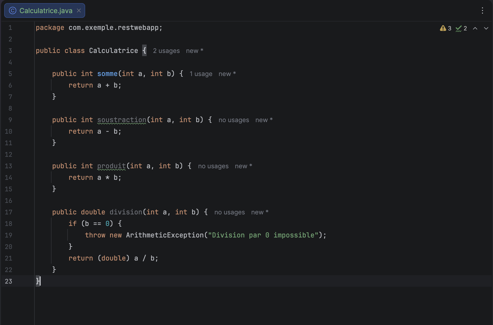
  <br>
  <em>Figure 5 : : Classe Calculatrice </em>
</p>

### C.2 L'activation de JAX-RS : classe RestApplication
<p align="center">
  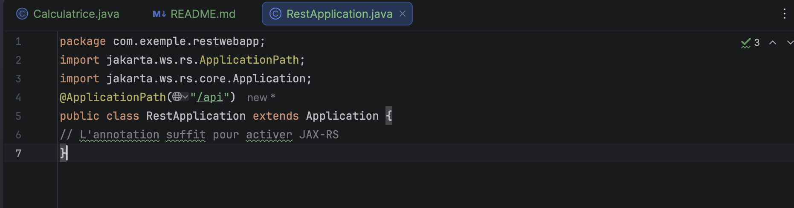
  <br>
  <em>Figure 6 : : Classe RestApplication</em>
</p>

### C.3 La ressource REST : classe CalculRest
<p align="center">
  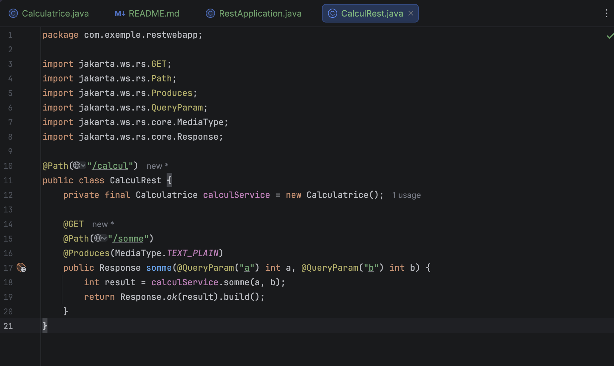
  <br>
  <em>Figure 6 : : Classe CalculRest</em>
</p>

Rôle de chaque annotation :

| Annotation                  | Rôle                                         |
|-----------------------------|----------------------------------------------|
| `@Path("/calcul")` (classe) | Toutes les méthodes répondent sous `/calcul` |
| `@GET`                      | La méthode répond aux requêtes GET           |
| `@Path("/somme")` (méthode) | Complète l'URI : `/calcul/somme`              |
| `@Produces(TEXT_PLAIN)`      | La réponse est du texte brut                 |
| `@QueryParam("a")`           | Lit le paramètre `a` de l'URI et le convertit en entier |

`Response.ok(result).build()` construit une réponse de statut **200 OK**.

### C.4 Construction du .war

<p align="center">
  
  <br>
  <em>Figure 7 : : Construction du projet avec `mvn clean package` (BUILD SUCCESS)*</em>
</p>

<p align="center">
  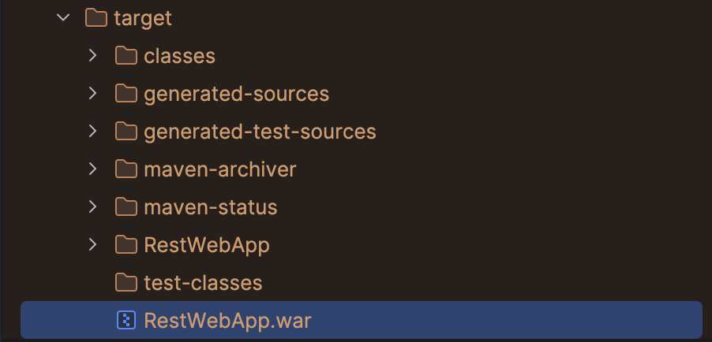
  <br>
  <em>Figure 8 : Fichier `RestWebApp.war` généré dans le dossier `target`</em>
</p>

### C.5 Déploiement dans Tomcat
Configuration d'exécution Tomcat 10.1.61 (Run > Edit Configurations…) :

Onglet Server : serveur Tomcat 10.1.61, navigateur lancé après démarrage.

Onglet Deployment : artefact RestWebApp:war exploded (application sous forme de dossier non compressé).

Application context : par défaut /RestWebApp_war_exploded. Pour obtenir l'URL de l'énoncé (/RestWebApp/api/...), il faut le remplacer par /RestWebApp dans le champ Application context.

<p align="center">
  
  <br>
  <em>Figure 9 : Onglet Server</em>
</p>
<p align="center">
  
  <br>
  <em>Figure 10 : Onglet Deployment</em>
</p>

### C.6 Décomposition de l'URL
`http://localhost:8080/RestWebApp/api/calcul/somme?a=2&b=3`

| Partie           | Origine                                      |
|------------------|----------------------------------------------|
| `localhost:8080` | Machine locale et port par défaut de Tomcat  |
| `/RestWebApp`    | Nom du `.war` / contexte de l'application    |
| `/api`           | `@ApplicationPath("/api")`                   |
| `/calcul`        | `@Path("/calcul")` de la classe              |
| `/somme`         | `@Path("/somme")` de la méthode              |
| `?a=2&b=3`       | Paramètres lus par `@QueryParam`             |

### C.7 Tests
<p align="center">
  
  <br>
  <em>Figure 11  Test avec Postman de `GET /RestWebApp/api/calcul/somme?a=2&b=3` : statut 200 OK et résultat 5</em>
</p>

Question C.1 : remplacer GET par POST dans Postma

<p align="center">
  
  <br>
  <em>Figure 12  Remplacement de  GET par POST dans Postma: statut 405 Method Not Allowed</em>
</p>

**Explication :** l'URI `/calcul/somme` existe bien, mais la méthode Java n'est annotée que par `@GET`. Aucune méthode de la ressource ne répond au verbe POST : Jersey distingue donc « ressource inexistante » (404) de « ressource existante mais verbe non supporté » (405) et indique les verbes autorisés dans l'en-tête `Allow: GET, HEAD, OPTIONS`.

## 6. Partie D : Compléter la calculatrice
### D.1 Soustraction et produit
Les méthodes soustraction et produit sont ajoutées à la classe CalculRest sur le modèle de la méthode somme : chacune est annotée par @GET, @Path et @Produces(MediaType.TEXT_PLAIN) et lit les paramètres a et b avec @QueryParam.
<p align="center">
  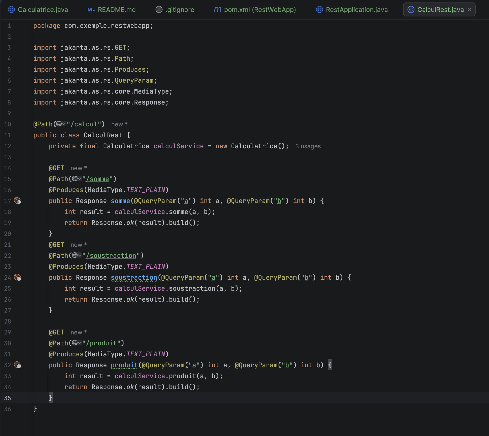
  <br>
  <em>Figure 13:Code des méthodes soustraction et produit dans la classe CalculRest </em>
</p>

Le test de la soustraction avec Postman consiste à envoyer une requête GET avec les paramètres a=10 et b=4. Le serveur répond avec le statut 200 OK et le résultat 6, conformément à l’attendu.

<p align="center">
  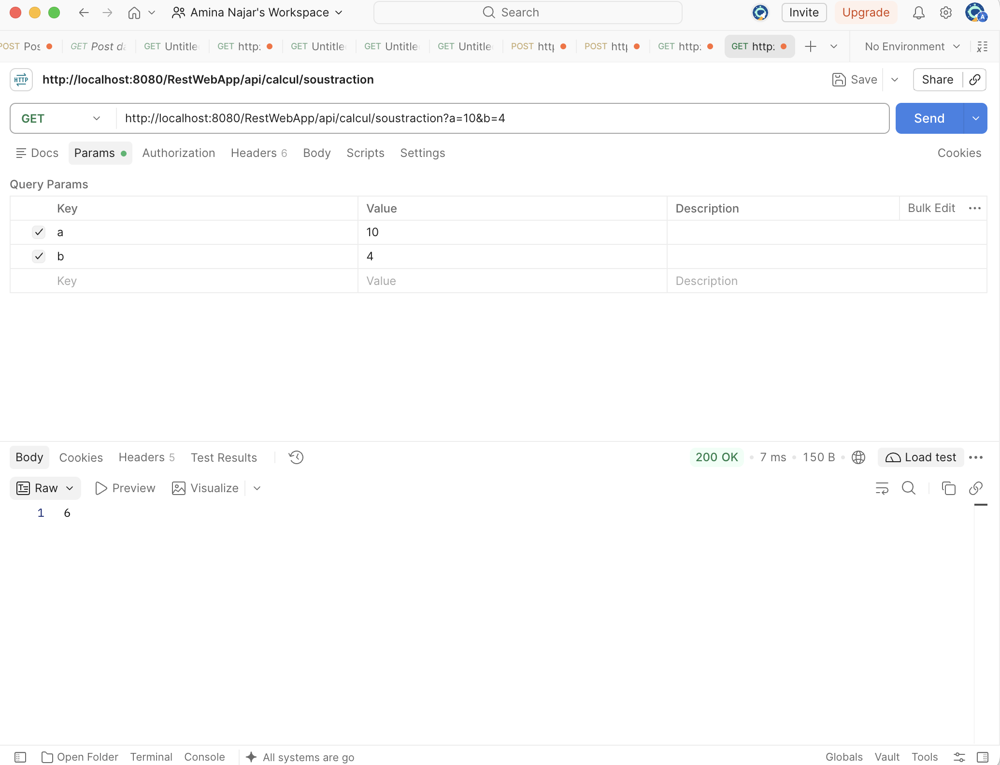
  <br>
  <em>Figure 14:Test avec Postman de GET /RestWebApp/api/calcul/soustraction?a=10&b=4 (statut 200 OK, résultat 6) </em>
</p>

Le test du produit avec Postman consiste à envoyer une requête GET avec les paramètres a=6 et b=7. Le serveur répond avec le statut 200 OK et le résultat 42, conformément à l’attendu.
<p align="center">
  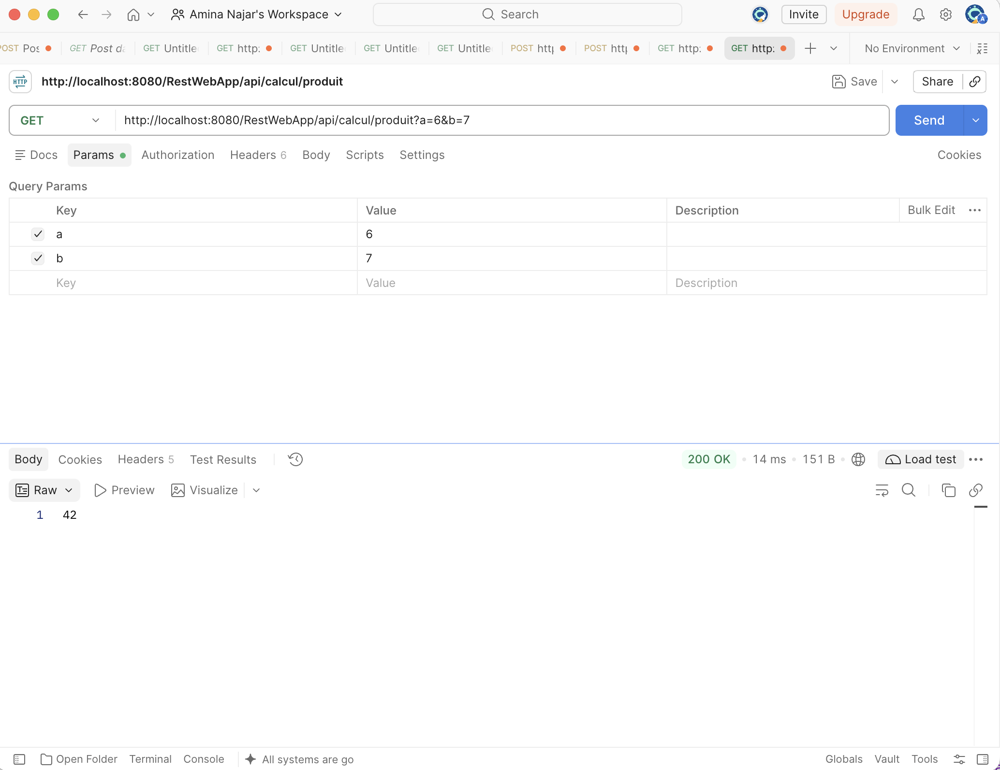
  <br>
  <em>Figure 15:Test avec Postman de GET /RestWebApp/api/calcul/produit?a=6&b=7 (statut 200 OK, résultat 42) </em>
</p>

### D.2 Division et gestion d'erreur

#### D.2.1 La classe CAlculRest :
<p align="center">
  
  <br>
  <em>Figure 16: Code de la méthode `division` avec gestion de la division par zéro dans la classe `CalculRest` </em>
</p>

#### D.2.2 Test de la Division normale :

<p align="center">
  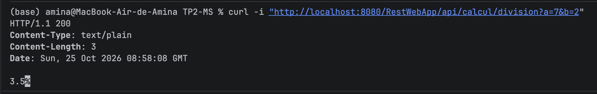
  <br>
  <em>Figure 17: Test avec curl -i de GET /RestWebApp/api/calcul/division?a=7&b=2 </em>
</p>

#### D.2.3 Test de la Division par zéro:

<p align="center">
  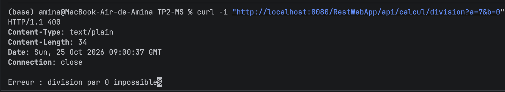
  <br>
  <em>Figure 18: Test avec curl -i de la division par zéro </em>
</p>

### D.3 Observations

 #### D.3.1 Resultat de la requête 1 (le paramètre b est absent)
<p align="center">
  
  <br>
  <em>Figure 19: Resultat de la requête 1 (le paramètre b est absent) </em>
</p>

#### D.3.2 Resultat de la requête 2 (le paramètre a n'est pas un entier)
<p align="center">
  
  <br>
  <em>Figure 20: Resultat de la requête 2 (le paramètre a n'est pas un entier) </em>
</p>

#### Question D.1. Quelle valeur JAX-RS donne-t-il à un paramètre entier absent ?
JAX-RS donne la valeur par défaut du type Java. Pour un int primitif, c'est 0
#### Question D.2. Quel statut obtenez-vous lorsque le paramètre n'est pas un entier ? La méthode somme a-t-elle été exécutée ?
La méthode somme n'est pas exécutée : la conversion de "abc" en int échoue avant l'appel de la méthode, et selon la spécification JAX-RS, un échec de conversion sur un @QueryParam ou @PathParam produit un 404.

### D.4 Paramètres dans le chemin : @PathParam

### D.4.1  l'Ajout de la méthode dans CalculRest:

<p align="center">
  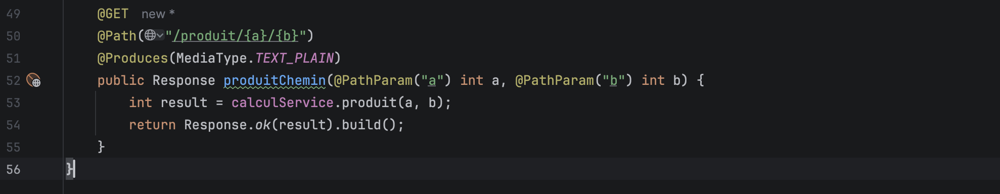
  <br>
  <em>Figure 21: l'Ajout de la méthode dans CalculRest </em>
</p>

### D.4.2  Test et résultat:
<p align="center">
  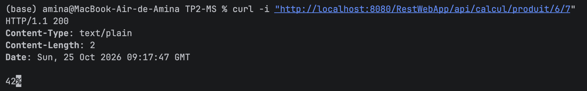
  <br>
  <em>Figure 22: Résultat du test</em>
</p>

#### Question D.3. Quelle différence y a-t-il entre @QueryParam et @PathParam ? Laquelle de ces deux annotations utilisera-t-on pour lire l'identifiant dans /operations/{id} ?
- `@QueryParam` lit une valeur dans la **chaîne de requête** après le `?` (`?a=6&b=7`). Les paramètres sont nommés, généralement optionnels, et servent plutôt à filtrer, trier ou paramétrer.

- `@PathParam` lit une valeur dans un **segment du chemin** défini par un modèle `{nom}` (`/produit/6/7`). La valeur fait partie de l'identité de la ressource.

Pour lire l'identifiant dans `/operations/{id}`, on utilise **`@PathParam("id")`**, car l'id identifie la ressource.

## 7. Partie E : Échanger des données en JSON
Jusqu'ici, le service renvoie un simple nombre en texte brut. Une API REST renvoie le plus souvent un
objet structuré au format JSON. La dépendance jersey-media-json-binding convertit
automatiquement un objet Java en JSON.

### E.1 Création de la Classe Resultat:

<p align="center">
  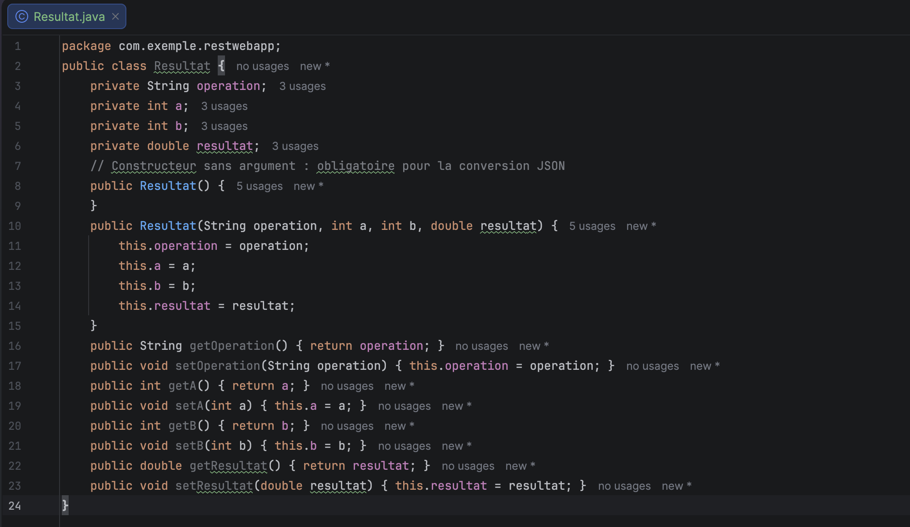
  <br>
  <em>Figure 23: Code de la Classe Resultat </em>
</p>

### E.2 Une méthode qui produit du JSON
####  E.2.1  code de la méthode sommeDetail
La méthode sommeDetail est ajoutée à la classe CalculRest pour renvoyer le résultat sous forme d’objet JSON. Seule l’annotation @Produces(MediaType.APPLICATION_JSON) change par rapport à la méthode somme : un objet Resultat est construit avec l’opération, les deux opérandes et le résultat, puis Jersey le convertit automatiquement en JSON.

<p align="center">
  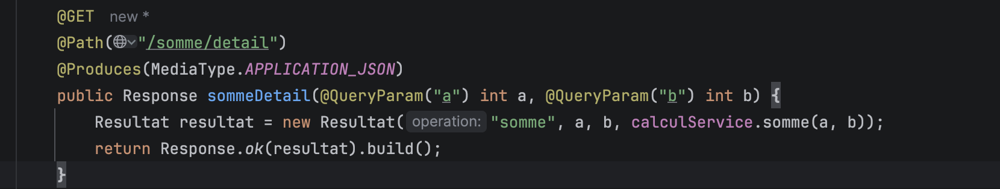
  <br>
  <em>Figure 24: Code de la méthode sommeDetail produisant une réponse au format JSON dans la classe CalculRest </em>
</p>

### E.2.2 Test : 
<p align="center">
  
  <br>
  <em>Figure 25: Test de la méthode sommeDetail </em>
</p>

#### Question E.1. Vous n'avez écrit aucune ligne de code pour fabriquer ce texte JSON. Qui a effectué la conversion ? D'où viennent les noms a, b, operation et resultat ?

La conversion est réalisée par Jersey, grâce à son module jersey-media-json-binding, qui s'appuie sur JSON-B (Jakarta JSON Binding) : un MessageBodyWriter sérialise l'objet Resultat en JSON lorsque le type produit est application/json. Les noms a, b, operation, resultat proviennent des propriétés JavaBean de la classe, c'est-à-dire des accesseurs (getA() → a, getOperation() → operation…). JSON-B les classe par ordre alphabétique, d'où l'ordre observé.

### E.3 L'en-tête Accept
Le client indique le format qu'il souhaite recevoir avec l'en-tête HTTP Accept. Avec curl, l'option -H
ajoute un en-tête à la requête.

<p align="center">
  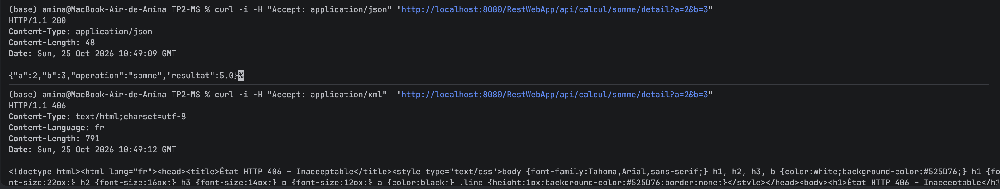
  <br>
  <em>Figure 26: Test de deux requêtes </em>
</p>

#### Question E.2. Pourquoi la seconde requête est-elle refusée ?
Le client demande du XML (Accept: application/xml) alors que la méthode ne sait produire que du JSON (@Produces(APPLICATION_JSON)). Aucun format ne satisfait à la fois le client et le serveur : Jersey répond 406 Not Acceptable (négociation de contenu impossible)

### E.4 Exercice : divisionDetail
#### E.4.1 la Méthode  divisionDetail:
La méthode divisionDetail est ajoutée à la classe CalculRest et répond à GET /calcul/division/detail?a=..&b=... Si b vaut 0, elle renvoie le statut 400 (Bad Request) avec un message d’erreur au format JSON. Sinon, elle construit un objet Resultat contenant l’opération, les deux opérandes et le résultat de la division, que Jersey convertit automatiquement en JSON avec le statut 200 (OK).
<p align="center">
  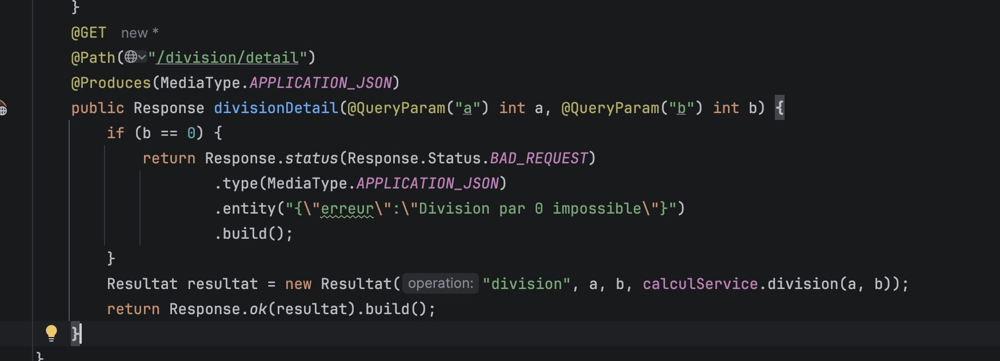
  <br>
  <em>Figure 27: Code de la méthode divisionDetail  </em>
</p>

#### E.4.2 Test et Résultat :
<p align="center">
  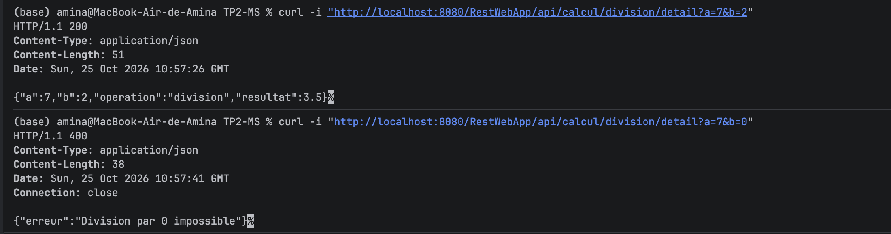
  <br>
  <em>Figure 28: Test et Résultat  </em>
</p>

## 8. Partie F : La ressource « operations » : POST, GET, PUT, DELETE
### F.1 Classe Operation
<p align="center">
  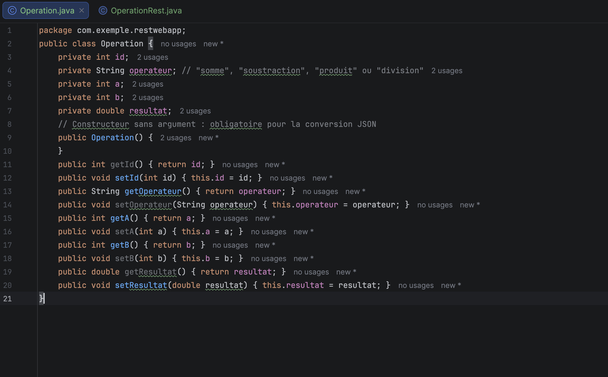
  <br>
  <em>Figure 29:Code de la classe Operation  </em>
</p>

### F.2 La classe OperationRest : créer et lire
<p align="center">
  
  <br>
  <em>Figure 30 :Code de la classe OperationRest (partie1) </em>
</p>
<p align="center">
  
  <br>
  <em>Figure 31 :Code de la classe OperationRest (partie2) </em>
</p>
**Points clés :**

- `@Produces` sur la classe s'applique à toutes les méthodes.
- `@Consumes(APPLICATION_JSON)` : le corps de la requête est du JSON, converti par Jersey en objet `Operation`.
- `Response.created(location)` : statut **201 Created** + en-tête `Location` pointant vers la nouvelle ressource.
- **Pourquoi `static` ?** JAX-RS crée une nouvelle instance de `OperationRest` **à chaque requête**. Un attribut d'instance serait donc vide à chaque appel. Un attribut `static` appartient à la classe et est partagé par toutes les requêtes. Comme celles-ci peuvent être simultanées, on utilise `ConcurrentHashMap` et `AtomicInteger`, conçus pour les accès concurrents (thread-safe).

### F.3 Tester la création et la lecture

#### Test 1 : Création d'une opération « somme » (`POST /operations`, 201 Created)

- **Corps envoyé :** `{"operateur":"somme","a":8,"b":2}`
- **Attendu :** statut 201, en-tête `Location` se terminant par `/operations/1`, corps `{"a":8,"b":2,"id":1,"operateur":"somme","resultat":10.0}`

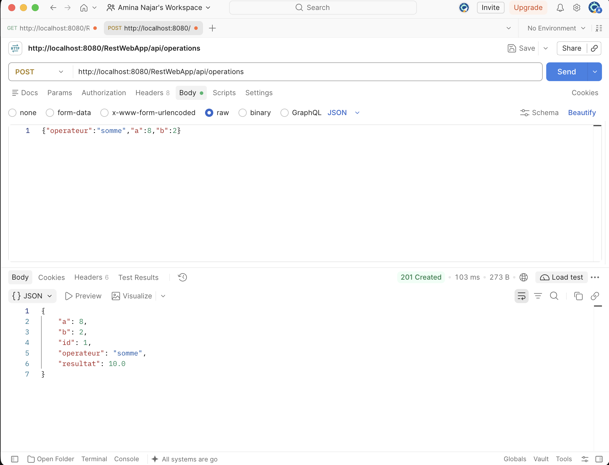
*Figure 32 : Création d'une opération « somme » avec Postman (statut 201 Created)*

#### Test 2 : Création d'une opération « division » (`POST /operations`, 201 Created)

- **Corps envoyé :** `{"operateur":"division","a":7,"b":2}`
- **Attendu :** statut 201, opération d'identifiant 2, résultat 3.5

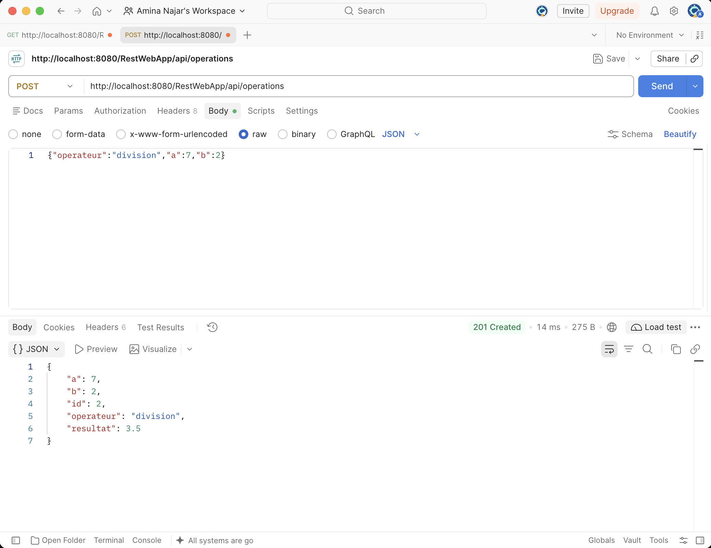
*Figure 33 : Création d'une opération « division » (statut 201 Created)*

#### Test 3 : Lecture de toutes les opérations (`GET /operations`, 200 OK)

- **Corps envoyé :** aucun
- **Attendu :** statut 200, tableau JSON contenant les deux opérations

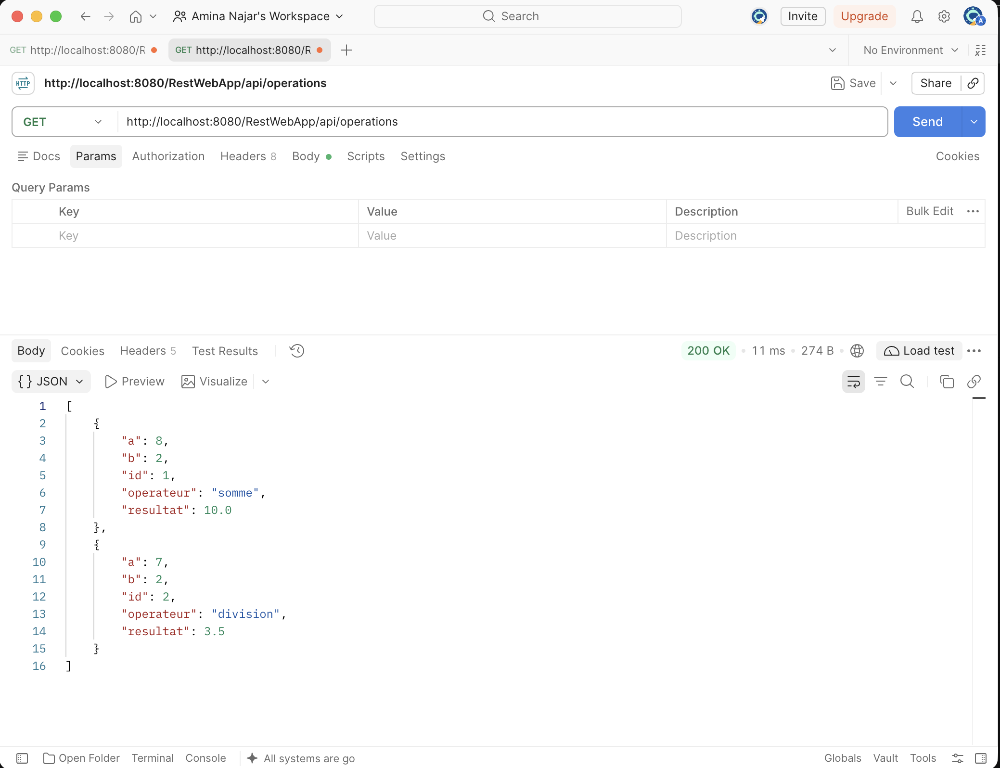
*Figure 34 : Liste de toutes les opérations enregistrées (statut 200 OK)*

#### Test 4 : Lecture d'une opération existante (`GET /operations/2`, 200 OK)

- **Corps envoyé :** aucun
- **Attendu :** statut 200, opération d'identifiant 2

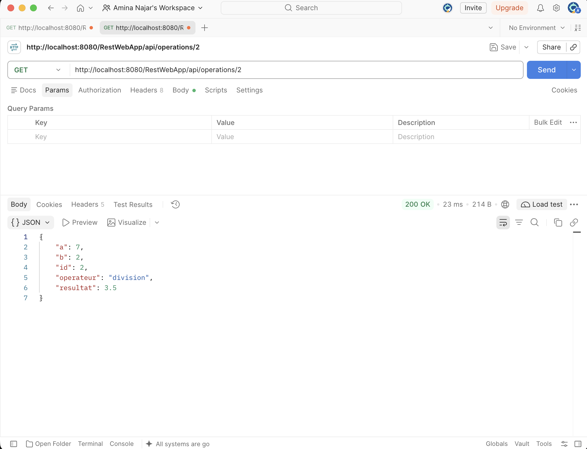
*Figure 35 : Lecture de l'opération d'identifiant 2 (statut 200 OK)*

#### Test 5 : Lecture d'une opération inexistante (`GET /operations/99`, 404 Not Found)

- **Corps envoyé :** aucun
- **Attendu :** statut 404, corps vide

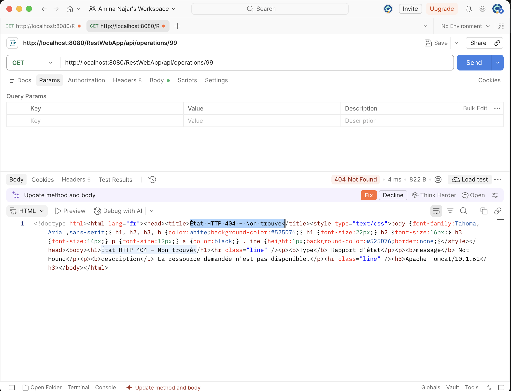
*Figure 36 : Lecture d'une opération inexistante (statut 404 Not Found)*

#### Test 6 : Création avec division par zéro (`POST /operations`, 400 Bad Request)

- **Corps envoyé :** `{"operateur":"division","a":7,"b":0}`
- **Attendu :** statut 400, corps `{"erreur":"Calcul impossible"}`

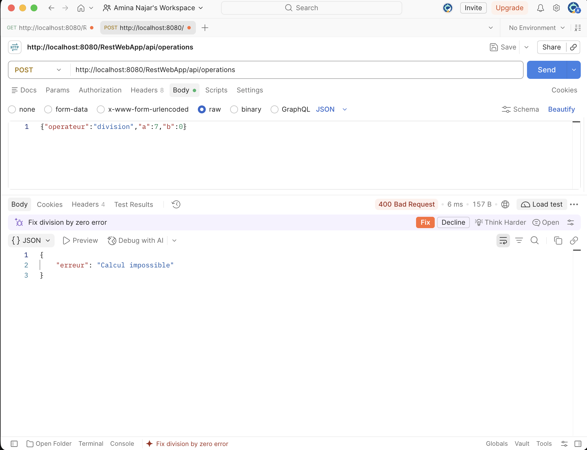
*Figure 37 : Création refusée pour division par zéro (statut 400 Bad Request)*

#### Test 7 : Création avec un opérateur inconnu (`POST /operations`, 400 Bad Request)

- **Corps envoyé :** `{"operateur":"racine","a":9,"b":0}`
- **Attendu :** statut 400, corps `{"erreur":"Calcul impossible"}`

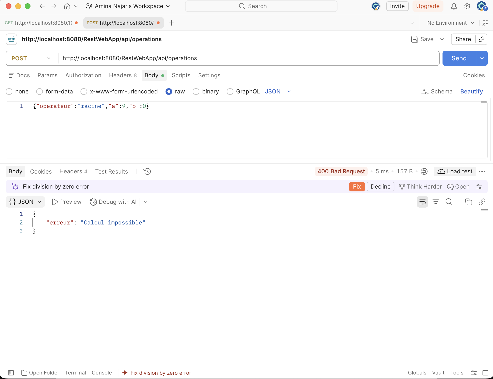
*Figure 38 : Création refusée pour opérateur inconnu (statut 400 Bad Request)*

### F.4 Modifier une opération : PUT 
#### F.4.1  la méthode modifier
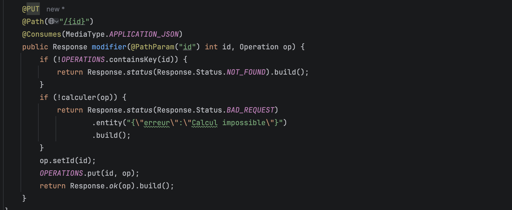
*Figure 38 : Code de la méthode modifier*
#### F.4.2 TESTS 
Les tests s'appuient sur l'opération d'identifiant 1, créée au préalable par
`POST /operations` avec le corps `{"operateur":"somme","a":8,"b":2}`.

#### Test 1 : Création de l'opération à modifier (`POST /operations`, 201 Created)

Une opération est d'abord créée pour disposer d'une ressource à modifier. Le serveur
calcule le résultat, attribue l'identifiant 1 et répond avec le statut 201.

- **Requête :** `POST http://localhost:8080/RestWebApp/api/operations`
- **Corps envoyé :** `{"operateur":"somme","a":8,"b":2}`
- **Attendu :** statut 201, `"id":1`, `"operateur":"somme"`, `"resultat":10.0`

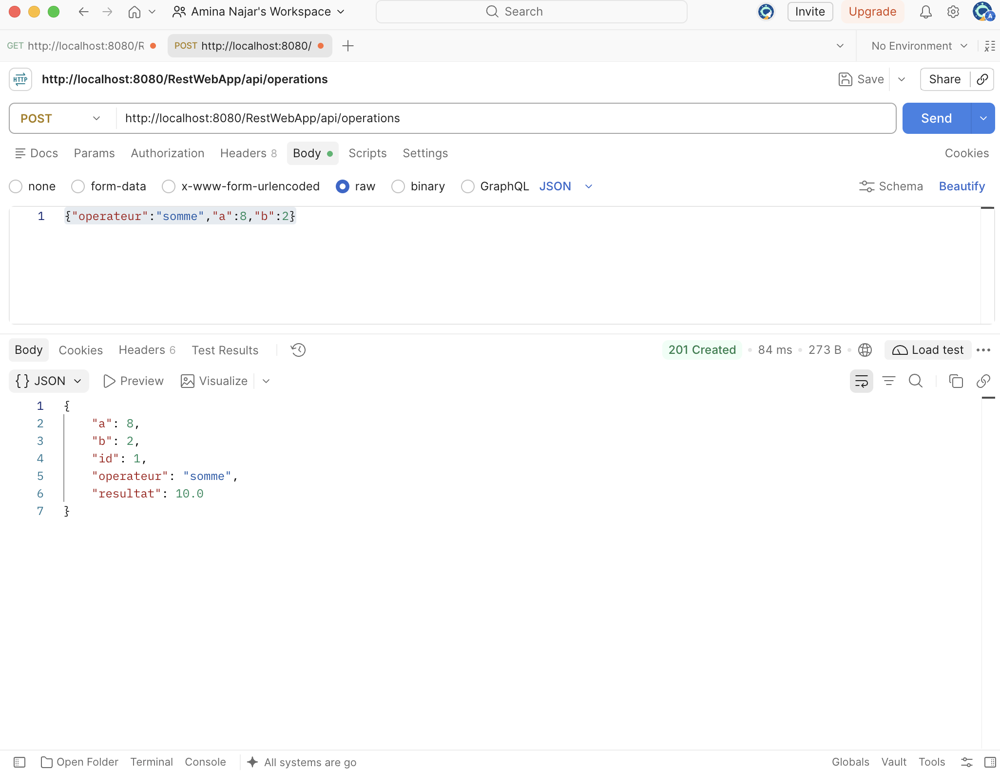
*Figure 39 : Création de l'opération d'identifiant 1 avec Postman (statut 201 Created,
résultat 10.0)*

#### Test 2 : Modification de l'opération (`PUT /operations/1`, 200 OK)

Une requête PUT remplace l'opération d'identifiant 1 par un produit. Le serveur
recalcule le résultat, conserve le même `id` et répond avec le statut 200.

- **Requête :** `PUT http://localhost:8080/RestWebApp/api/operations/1`
- **Corps envoyé :** `{"operateur":"produit","a":8,"b":2}`
- **Attendu :** statut 200, `"id":1`, `"operateur":"produit"`, `"resultat":16.0`

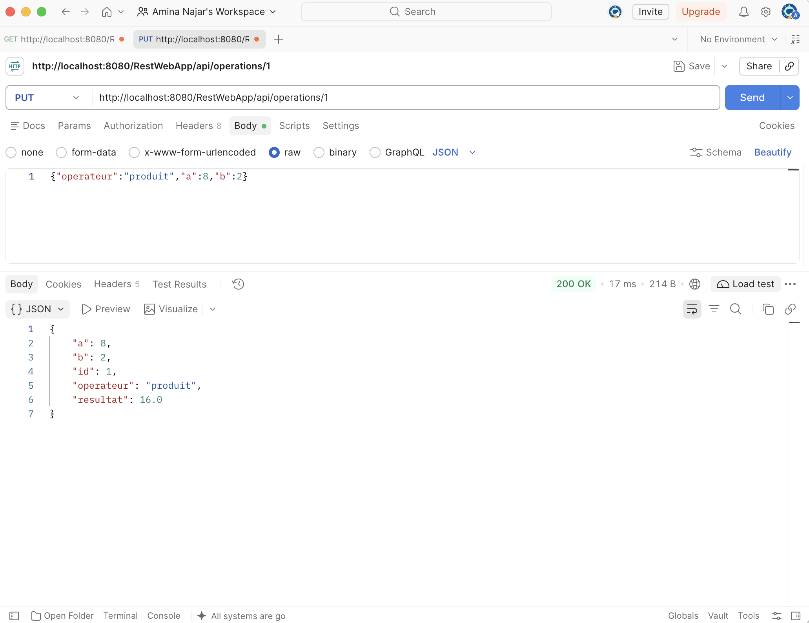
*Figure 40 : Modification de l'opération 1 avec Postman (statut 200 OK, résultat 16.0)*

#### Test 3 : Vérification de la modification (`GET /operations/1`, 200 OK)

Une requête GET sur l'identifiant 1 permet de vérifier que la modification est bien
enregistrée : l'opérateur est devenu `produit` et le résultat vaut `16.0`.

- **Requête :** `GET http://localhost:8080/RestWebApp/api/operations/1`
- **Corps envoyé :** aucun
- **Attendu :** statut 200, `"operateur":"produit"`, `"resultat":16.0`

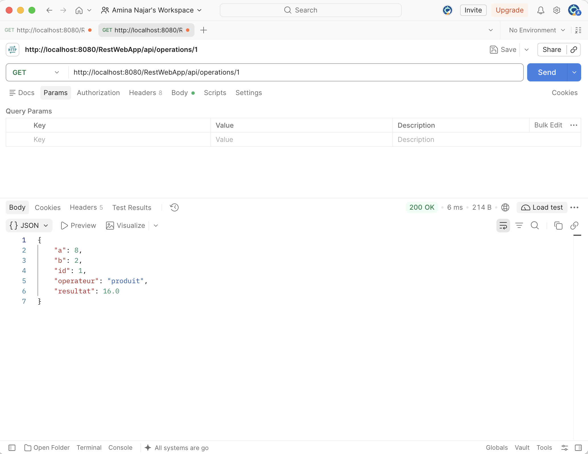
*Figure 41 : Vérification de l'opération 1 après modification (statut 200 OK,
résultat 16.0)*

### F.5 Supprimer une opération : DELETE 
#### F.5.1 la methode DELETE
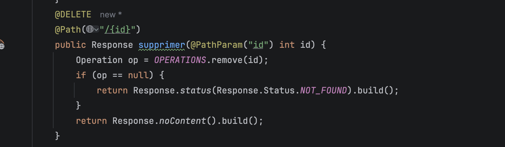
*Figure 43 : code de la methode DELETE *
#### F.5.2 Tests
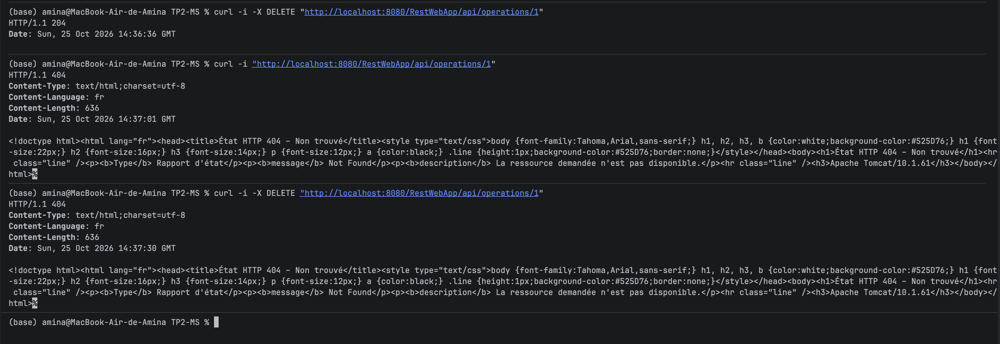
*Figure 44 : Suppression de l'opération 1 avec curl : `DELETE` (204 No Content), `GET`
(404 Not Found), puis second `DELETE` (404 Not Found)*

### 9 Questions de synthèse
#### 1. Tableau de l'étape A.1 avec les codes de statut

| Verbe  | URI                        | Rôle                        | Statuts possibles                                                                       |
|--------|----------------------------|-----------------------------|-----------------------------------------------------------------------------------------|
| GET    | `/calcul/somme?a&b`        | a + b                       | - **200** (OK)<br/> -  **404** (Not Found)  si un paramètre n'est pas un entier                                       |
| GET    | `/calcul/soustraction?a&b` | a − b                       |- **200**(OK)  <br/> - **404**  (Not Found) si paramètre non entier                                                   |
| GET    | `/calcul/produit?a&b`      | a × b                       | - **200**(OK)  <br/> -  **404**  (Not Found)si paramètre non entier                                                   |
| GET    | `/calcul/division?a&b`     | a ÷ b                       | - **200** (OK) <br/>- **400** (Bad Request)  si b = 0 <br/> - **404**  (Not Found) si paramètre non entier                                |
| POST   | `/operations`              | Crée une opération          | - **201** (Created)<br/> - **400** (calcul impossible ou JSON invalide) <br/>- **415**(Unsupported Media Type) si `Content-Type` non JSON |
| GET    | `/operations`              | Liste toutes les opérations | -**200**(OK) (tableau éventuellement vide)                                                   |
| GET    | `/operations/{id}`         | Lit l'opération id          |- **200** (OK) <br/>-**404** (Not Found) si id inconnu                                                         |
| PUT    | `/operations/{id}`         | Modifie l'opération id      | -**200**(OK) <br/> -**400** (Bad Request) (calcul impossible) ; **404** si id inconnu ; 415                     |
| DELETE | `/operations/{id}`         | Supprime l'opération id     | -**204** (No Content) <br/>-  **404** (Not Found)si id inconnu                                                         |

#### 2. Annotations JAX-RS utilisées

| Annotation | Rôle |
|---|---|
| `@ApplicationPath` | Active JAX-RS et définit le préfixe commun des URI (`/api`) |
| `@Path` | Associe une classe ou une méthode à un chemin d'URI (peut contenir `{param}`) |
| `@GET` | La méthode répond aux requêtes HTTP GET |
| `@POST` | La méthode répond aux requêtes POST (création) |
| `@PUT` | La méthode répond aux requêtes PUT (modification/remplacement) |
| `@DELETE` | La méthode répond aux requêtes DELETE (suppression) |
| `@Produces` | Type MIME du corps de la réponse (`text/plain`, `application/json`) |
| `@Consumes` | Type MIME attendu pour le corps de la requête |
| `@QueryParam` | Injecte un paramètre de la chaîne de requête (`?a=2`) |
| `@PathParam` | Injecte une valeur d'un segment du chemin (`/{id}`) |
| `@Context` | Injecte un objet du contexte JAX-RS (ici `UriInfo`) |

#### 3. Différence entre JAX-RS et Jersey
- JAX-RS (Jakarta RESTful Web Services) est une spécification : elle définit une API (annotations, classes comme Response, Application) mais ne contient pas de moteur.
- Jersey est une implémentation de cette spécification c'est lui qui analyse les annotations, route les requêtes et convertit les données.

#### 4. Rôle de Tomcat
Tomcat est un conteneur de servlets (serveur web d'applications Java). Il écoute sur le port HTTP (8080), reçoit les requêtes, gère le cycle de vie des applications déployées et les transmet à la servlet de Jersey, qui les aiguille vers nos classes.
##### pourquoi un .war et non un .jar exécutable ?
Le projet produit un .war car c'est le format standard d'une application web destinée à être déployée dans un serveur existant : ce serveur fournit le réseau et les servlets. Un .jar exécutable devrait embarquer son propre serveur (approche de Spring Boot), ce qui n'est pas le cas ici.

#### 5. Stateless et liste des opérations

Le principe *stateless* signifie que chaque requête contient les informations nécessaires à son traitement, sans mémoriser la session du client. La liste des opérations représente l'**état des ressources**, partagé entre tous les clients, et non l'état d'une session. Par exemple, `GET /operations/2` retourne la même opération quel que soit l'historique du client. Le stockage en mémoire est une simplification du TP ; une base de données pourrait être utilisée à la place.

#### 6.Répétition de POST et de PUT
- POST /operations envoyé deux fois : crée deux ressources distinctes (id 1 puis id 2) avec le même contenu. L'état du serveur change à chaque envoi. POST n'est pas idempotent.
- PUT /operations/1 envoyé deux fois : le second appel remplace l'opération par le même contenu. L'état final est identique à celui obtenu après un seul appel. PUT est idempotent.
 
### 10. Conclusion

Ce TP a permis de concevoir une API REST à partir de ressources et de verbes HTTP, de créer un projet Maven de type war, d'écrire un service avec JAX-RS/Jersey, de le déployer sur Tomcat 10.1 et de le tester avec curl et Postman. Il a aussi permis de manipuler les codes de statut (200, 201, 204, 400, 404, 405, 406) pour signaler précisément le résultat de chaque requête, et de comprendre la différence entre verbes sûrs, idempotents et non idempotents.